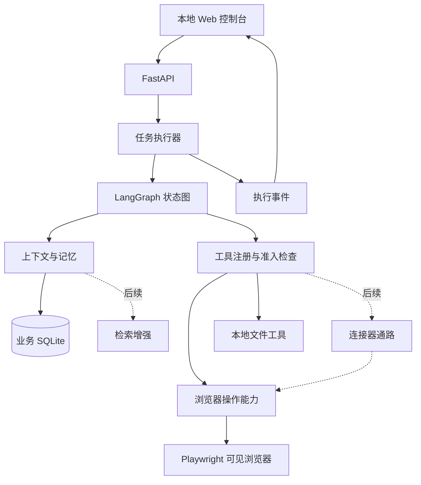

# Orbit：网页操作特化 Agent MVP 计划

更新日期：2026-09-21。项目目录：`E:\bbbooottt`。

本文按 2026-09-21 确定的定位重写。此前版本以「本地资料 → GitHub → Notion → 本地报告」为主演示，已废弃，变更沿革见第 17 节。

## 1. 项目定位

一个本机运行的 Agent，**核心能力是操作真实浏览器里的各类网站**。用户用自然语言说出目标，Agent 自己判断该去哪个站点、打开它、进入它，并在站内完成多步操作。

与"调 API 拼结果"的助手的区别：它像人一样看页面、点元素、填内容、翻页、处理登录，而不是依赖每个平台各自的接口。因此平台接入成本不随站点数量线性增长——新增一个站点通常不需要写适配器。

单用户、本机运行、一次执行一个任务。使用可见 Chromium 与独立持久化 Profile，用户随时能看到它在做什么，也能随时接管。

本地文件与跨对话记忆是辅助能力，不是卖点：文件用于存取素材与结果，记忆用于沉淀站点偏好与操作习惯。

浏览器操作是默认通路，但不是唯一通路。连接器（2.6）与检索增强（2.5 第 4 条）是后续方向，用来在高频平台与大规模素材上提速；它们不改变"先能进站、能操作"的定位。

## 2. 范围与完成线

### 2.1 完成线（MVP 门槛）

用户定义：**Agent 能从自然语言目标里识别出该去哪个站点，并成功打开进入该站点，即视为 MVP 完成。**

判定"成功进入"的条件：导航后 URL 落在目标域名内、页面标题非空、可见正文非空，且不是错误页或被拦截页。进入后如果撞上登录墙，允许进入人工接管流程，接管后成功进入同样算达成。

### 2.2 质量指标：单站点深度操作

完成线之上，用**单站点深度操作**衡量能力深度，而不是站点数量。以一个站点为对象，连续完成多步操作链：

> 例：B 站 —— 打开 → 搜索关键词 → 按播放量排序 → 翻页 → 进入视频详情页 → 提取标题、UP 主、播放量、发布时间。

深度操作过程必须全部落在真实 DOM 操作上，不使用站点 API。这是加分项，不是门槛。

### 2.3 能力清单

| 能力 | MVP 范围 |
|---|---|
| 站点识别 | 从自然语言目标推断目标站点与入口 URL，必要时向用户确认 |
| 站点进入 | 导航、域名准入判断、进入成功判定、入口 URL 失效时更换入口 |
| 观察—行动—验证 | 页面观察、带版本号的元素引用、点击、输入、按键、滚动、截图、动作后重新观察 |
| 站内多步操作 | 搜索、筛选、排序、翻页、进详情、字段抽取（作为深度指标） |
| 登录与接管 | 专用持久化 Profile；遇登录墙或验证时暂停，用户处理后再继续 |
| 本地文件（辅助） | 授权目录内列举、文本搜索、读取、写入结果；不用于验收 |
| 跨对话记忆（辅助） | 记住站点偏好、输出语言、常用入口、登录习惯；可查看、修改、删除 |
| 前端工作台 | 聊天、过程说明、确认与接管、设置；不恢复任务面板 |

### 2.4 本版（MVP 门槛）明确不做

以下是不属于"识别站点并进入"这条完成线的内容，其中大部分会进入后续方向，不是永久放弃：

- 不要求产出报告，也不把"可核验证据产物"当作验收条件。结果可以落盘，但落盘不是目的。
- 不做对站点的写入动作（评论、投币、发布、提交等），除非用户在具体任务中明确要求。**例外**：用密钥存储中的账号自动登录会提交登录表单，属于对站点的写入，已由用户明确要求并实现（见 16.5）；这类提交始终逐次确认，不可设为免确认。
- 不要求跨站点串联任务，也不要求评估集与完成率统计——这两项属于后续方向第 3、5 条。
- MVP 阶段不预先为任何站点写适配器。连接器作为独立方向保留，见 2.6。

### 2.5 后续方向

按优先级排列，完成线达成后依次推进：

1. **Computer-use 式类人操控**：从"浏览器内 DOM 操作"走向"窗口级操控"，包括鼠标键盘事件、窗口切换、跨应用操作，用于 DOM 定位失效或画布类页面。这是完成线之后的主要演进方向。
2. **连接器方向**：为高频或提供 API 的平台建立正式连接器，见 2.6。
3. **多平台与跨站点任务**：更多站点的泛化验证，以及一条任务里串联多个站点。
4. **RAG**：当素材规模超过单次上下文承载时，引入分块、Embedding、向量召回与来源引用，服务于本地资料与网页内容的检索。**进展（2026-10-08）**：写入侧分块 + FTS5 双路与读取侧 RRF 融合已上线；向量路（阶段 6）已落地并**换用 `google/embeddinggemma-300m`（768 维）**——`sqlite-vec` vec0 + `fastembed` 本地嵌入作为 RRF 第 3 路，默认开关 `vector_enabled=False`，真实库 524 块已回填。**换模型带来实质提升**（A 改写查询集融合 recall@5 0.375→0.562、B 词面查询集 0.667→0.750、B 向量单路 0.583→0.917），**但验收门槛仍未过**（门 2 要求 0.70、门 3 要求 0.85）：实测已定位**瓶颈是 RRF 融合公式而非模型**——B 集向量单路 0.917 被三路融合压回 0.750，而给向量路加权已被证伪。代价是嵌入慢 5.6×（31ms→173ms/块），需上后台嵌入队列。详见 `handoff/vector-path-plan.md` 第二轮。**第三轮补丁（同日）**：落地**第三档 cross-encoder 重排（`BAAI/bge-reranker-base`）+ 查询类型路由 + 词面覆盖门**（`app/rerank.py`，第 12 个 policy `Reranker`）。**门 3 首次通过**（B 集 0.750→**0.917**，与向量单路持平）；A 集 0.562→**0.625**（仍差 0.075）。A 集残差经诊断追到根因是**表格被整表切块、目标单元格信号被稀释**（A 集目标块 62.5% 是表格块、命中率 50% vs 正文 83%）——**不是排序问题，是切块粒度问题**，故另立「检索质量专项」（表格行级切块 + 查询集扩容）。**收口（同日）**：`vector_enabled` 与 `rerank_enabled` **默认双双翻 `True`**（Hermes 经验：向量按需、cross-encoder 是唯一真见效的第三档；本项目 B 集过门证据）；回退一句话 `ORBIT_VECTOR_ENABLED=0` / `ORBIT_RERANK_ENABLED=0`。**RAG 方向至此收口**——门 2 维持未过不再追，余项移交阶段 6.5。详见 `handoff/vector-path-plan.md` 第三轮与收口节。**第四轮（2026-10-09）**：落地**表格行级切块**（`split_table` 改「一条数据行 + 表头成一块」，废除「整表 ≤500 字一块 / 400 字行组切」）——A 集 **0.625→0.688**、B 集 **0.917→1.000**（pytest 248 passed）；四档粒度对照确证行级最优，但候选池天花板恒为 0.812，**门 2（≥0.70）仍差 1 条**，残差 = 嵌入模型判别力上限（`LIST_DEPTH` / FTS 门控 / 路径权重 / 切块粒度四个杠杆全部实测否掉）。剩余修法：查询集扩容 ≥50 条、多向量 / HyDE、换更强模型。详见 `handoff/vector-path-plan.md` 第四轮。
5. **评估集与实测指标**：构建约 10 个固定任务，记录完成率、错误归因、工具调用次数、耗时、接管次数，作为可对外展示的量化数据。
6. **稳定性增强**：重试策略、页面变化检测、反爬与验证码的人工接管体验优化。

### 2.6 连接器方向

浏览器操作是通用通路，连接器是**加速器**，两者并存而不是互相替代。

- **定位**：连接器描述一个平台的认证方式、状态与能力集合，每项能力注册为工具。Agent 调用能力，连接器内部决定走 API 还是走网页。
- **取舍原则**：能用官方 API 的用连接器——更快、更稳、可分页、不依赖页面结构；没有 API、API 覆盖不到、或必须复用用户已登录网页态的，走浏览器操作。同一个平台也可以一半走 API、一半走网页。
- **不做的事**：不为"看起来应该有个连接器"的站点预先写适配器。只有在某个站点被反复使用、且浏览器通路明显吃亏时，才为它建连接器。
- **与 MVP 的关系**：现有 GitHub 连接器与 Notion 网页适配代码保留，作为该方向的起点，但不参与"识别站点并进入"这条完成线的验收。
- **后续可扩展**：统一的工具契约（读写属性、目标范围、超时、`operation_id`、证据引用）在各连接器之间保持一致，便于之后接入更多平台或外部工具协议。

## 3. 技术栈

| 组件 | 选择 | 原因 |
|---|---|---|
| Python 环境 | Python 3.12 + uv | 可复现环境 |
| API | FastAPI + Uvicorn | 异步接口、流式事件 |
| 数据契约 | Pydantic v2 | 校验模型输出与工具参数 |
| Agent 编排 | LangGraph | 显式状态、条件路由、checkpoint、interrupt/resume |
| 模型调用 | langchain-openai | 对接支持工具调用的 OpenAI 兼容模型 |
| 浏览器 | Playwright Python，headed Chromium | 真实可见浏览器、登录态复用、人工接管 |
| 持久化 | SQLite + SQLAlchemy 2 async + aiosqlite + Alembic | 本地低成本启动 |
| 图状态 | langgraph-checkpoint-sqlite | 独立 checkpoint 库 |
| 前端 | React + TypeScript + Vite | 展示对话与操作过程 |
| 实时进度 | SSE + REST | 服务端单向推送 |
| 凭证 | 系统 keyring；开发用本地环境变量 | 密钥不落业务库 |
| 验证 | pytest、pytest-asyncio、Ruff、Mypy、Bandit | 流程与接口测试 |

## 4. 系统结构



MVP 阶段所有站点都走同一套浏览器能力，站点差异体现在观察结果与操作序列上，不体现在代码分支上。虚线部分是后续方向：连接器为高频平台提供更快的通路，检索增强服务于大规模素材。

## 5. 执行流程

```text
理解目标并推断目标站点
  → 导航进入（任意 http(s) 站点，无域名限制）
  → 判断是否真的进去了
  → 观察页面，生成带版本号的元素引用
  → 选择下一步动作并执行
  → 重新观察并验证效果
  → 遇登录/验证/不确定时暂停，交回用户
  → 继续或结束
```

状态：`PENDING → RUNNING → WAITING_USER / SUCCEEDED / FAILED / CANCELLED`，等待原因区分 `login`、`verification`、`approval`、`clarification`、`recovery_check`。

默认最多 20 次工具动作；单个可重试读操作最多重试 2 次；动作上限触发时向用户说明原因，而不是抛通用错误。

## 6. 站点识别与进入

这是 MVP 的核心环节。

### 6.1 识别

模型从用户目标中推断目标站点与入口 URL。入口可以是首页，也可以是直达的搜索或列表页 URL。

### 6.2 无域名限制

**任意 http(s) 站点都可以直接访问，不设域名白名单。** 只校验地址格式：必须是 http/https、不能带用户名密码、不能是 `javascript:` 之类的伪协议。这条校验由 `http_url()` 承担，不是访问控制。

已删除的内容：原静态白名单（`browser.py` 的 `allowed()`）、内置的 GitHub/Notion/B 站域名列表、设置项 `browser_domains` 及其前后端字段。设置里的"网页起始地址"只用于"打开浏览器"按钮的默认起点，不再限制对话中能去哪里。

### 6.3 进入判定

导航后判断是否真的进入：URL 可达、HTTP 状态正常、标题非空、正文长度超过阈值（当前 200 字）。判定为弱页面时**不报错**，而是在观察结果里带上 `entry_weak` 与 `entry_note`，让模型自己看到"可能没进去或需要登录"并决定换入口还是请求接管——比硬编码回退规则更灵活，也不需要为每个站点维护规则。

## 7. 浏览器操作循环

1. 启动专用 Profile 的可见浏览器，不使用用户日常浏览器 Profile。
2. 观察：URL、标题、主要文本、可交互元素的 role/name，以及截图。
3. 每次观察生成有版本号的元素引用；模型只能选择当前观察中的元素，不凭空写 selector。
4. 执行：映射到 Playwright locator，依赖自动等待与可点击性检查。
5. 页面跳转或重绘后重新观察，过期引用作废。
6. 优先 DOM 与语义定位；截图用于辅助理解与用户查看。

## 8. 登录与接管

用户在专用浏览器中登录站点，Cookie 留在本机 Profile，不暴露给模型。检测到登录页、验证页或无法确定的阻断时暂停并说明原因，用户在本机窗口处理后点击继续，系统重新观察确认可访问再继续。

过程说明只展示对操作的简短说明，不展示模型原始思维链。

## 9. 记忆与本地文件

- 长期记忆只保存用户明确要求记住的内容，以及使用过程中沉淀的站点偏好（常用站点、入口、输出语言、登录习惯）。可查看、修改、删除；删除后不再注入。
- 短期记忆保留当前会话最近消息与摘要，注入量受预算约束。
- 本地文件作为辅助：读取素材、保存结果。路径必须落在授权目录内，覆盖已有文件需授权。
- 密码、Token、Cookie 不进入记忆或模型上下文。

## 10. 工具契约

工具定义包含名称、说明、Pydantic 参数模型、确认开关。结果包含 `status`、`data`、`error`，状态区分 `ok`、`error`、`needs_user`、`uncertain`。

| 分类 | 工具 |
|---|---|
| 浏览器 | `browser.observe`、`browser.navigate`、`browser.click`、`browser.fill`、`browser.press`、`browser.scroll` |
| 本地（辅助） | `local.list_files`、`local.search_text`、`local.read_document`、`local.write_report` |
| 记忆 | `memory.search`、`memory.save`、`memory.delete` |
| 交互 | `ask_user` |

不引入按站点划分的工具命名空间。若某个站点确实需要特殊处理，优先通过调整观察与操作序列解决。

## 11. 授权边界

- 后端绑定 loopback，检查来源，写接口不允许任意网页跨域调用。
- 导航目标必须落在第 6.2 节的准入规则内；本地回环与内网永远拒绝。
- 本地文件解析真实路径并校验仍在授权目录内，覆盖写需授权。
- 不提供通用删除与任意 Shell 工具。
- 页面内容视为任务数据，不能通过其中的文字改变工具权限或指示 Agent 外传文件。
- 对站点的写入动作默认不做；用户明确要求时仍需在聊天中确认目标与内容。

## 12. 开发顺序

- [x] **1. 放开站点限制。** 删除域名白名单与 `browser_domains` 设置，只保留地址格式校验；任意 http(s) 站点可直接导航。
- [x] **2. 进入判定。** 导航后检查 HTTP 状态、标题与正文长度，弱页面在观察结果里标注 `entry_weak`，由模型决定下一步。
- [x] **3. 站点识别验证（2026-09-21 实测通过）。** 真实模型能从自然语言目标推断出正确站点，并直接构造带参数的入口 URL，无需任何识别模块。详见 16.2。
- [x] **4. 单站点深度操作（5 步全部通过）。** 搜索、排序、抽字段、翻页、进详情均已实测，见 16.7。
- [~] **5. 登录与接管体验。** 自动登录已实测（16.5），接管门槛已收紧（16.9）；**完整的"暂停 → 人工处理 → 继续"循环仍未真实演练**。
- [x] **6. 记忆与本地文件接入（基础版）。** 长期偏好、对话摘要、本地读写均可用；站点偏好沉淀仍为简化版。
- [x] **7. 工作台与过程展示。** 聊天、摘要、连接设置、密钥存储四个视图；确认与接管在聊天内完成。
- [x] **8. 回归与稳定化。** 固定任务集 10 个用例 + 跑批脚本 + 报告，首轮 10/10，见 16.8。

## 13. 验收场景

| 场景 | 通过条件 |
|---|---|
| 站点识别 | 给定自然语言目标，推断出正确站点与可用入口 URL；不确定时向用户确认而不是乱猜 |
| 站点进入 | 导航后 URL、标题、正文均符合预期；入口失效时能换入口重试 |
| 单站点深度 | 在同一站点连续完成多步操作，最终拿到目标字段 |
| 登录接管 | 遇登录墙暂停并说明原因；用户处理后继续，重新验证页面可用 |
| 多轮修改 | "换个关键词""只要前五个"等追加要求作用于当前任务 |
| 记忆复用 | 新对话沿用站点偏好；修改后只用新值，删除后不再召回 |
| 越界防护 | 内网地址与非授权域名被拒绝；本地文件路径越界被拒绝 |
| 取消 | 取消后不再发起新动作，已完成的步骤仍可见 |

## 14. 目录结构

```text
E:\bbbooottt\
├── MVP_PLAN.md
├── backend/
│   ├── app/
│   │   ├── main.py          # API 与 SSE
│   │   ├── agent.py         # LangGraph 编排、准入与中断
│   │   ├── browser.py       # 可见浏览器、观察、动作、进入判定
│   │   ├── tools.py         # 工具注册与本地能力
│   │   ├── context.py       # 上下文与提示
│   │   ├── storage.py       # ORM
│   │   ├── summaries.py     # 对话摘要
│   │   └── config.py        # 设置与路径
│   └── tests/
├── frontend/
├── scripts/
└── data/                    # 运行时数据，不入 Git
```

## 15. 完成标志

Agent 能从自然语言目标识别出目标站点，真实打开并进入该站点，并在同一个站点上完成一段连续的多步操作。全过程使用真实可见浏览器与 DOM 操作，用户可随时接管。

不要求产出报告，不要求可核验产物，不要求接入特定平台。

## 16. 当前实现状态（2026-09-22 核对）

| 部分 | 状态 |
|---|---|
| 固定任务集与实测指标 | 已建立，10 个用例首轮 10/10，见 16.8 |
| 界面交互回归 | 13 组通过（新增密钥存储页一组），见 16.10 |
| MCP 服务接入（本地进程 / 远程 URL） | 已实现并实测，见 16.11 |
| 外部工具注册机制（不写代码就能加能力） | 已实现（MCP 通道）；HTTP 工具通道待做 |
| README 与新定位一致 | 已重写关键章节，见 16.10 |
| 可见浏览器、观察/点击/输入/按键/滚动/截图 | 已实现，真实窗口启动与导航已验证 |
| LangGraph 循环、checkpoint、中断与恢复、取消 | 已实现，测试通过 |
| 本地文件读写与搜索 | 已实现，读写已验证 |
| 长期偏好与对话摘要 | 已实现，简化版 |
| 前端工作台（聊天、摘要、设置、SSE 续传） | 已实现，12 组交互验证通过 |
| 后端测试 | 44 passed；Ruff、Mypy、前端 lint+build 通过 |
| 任意站点访问（无域名限制） | 已实现并实测：白名单与 `browser_domains` 已删除 |
| 进入判定（HTTP 状态、标题、正文长度、`entry_weak` 标注） | 已实现，实测未误报 |
| 站点识别（模型推断目标站点与入口 URL） | **实测通过**，见 16.2 |
| 单页应用渲染等待（`settle()`） | 已实现。此前在 `domcontentloaded` 时观察，SPA 站点看到的只是空壳 |
| 站点级免确认 | 已实现并实测，见 16.4 |
| 密钥存储模块（密钥 / 站点账号 / 登录状态） | 已实现并实测，见 16.5 |
| 用保存的账号自动登录（`vault_login`） | 已实现并实测，密码不经过模型 |
| 站内多步操作：搜索、排序、抽字段 | 已实测（B 站，抽 20 条） |
| 站内多步操作：翻页、进入详情页 | **已实测**，见 16.7 |
| 人工接管（登录墙 / 验证码 → 用户处理后继续） | 机制已有，**未真实演练** |

### 16.2 真实模型实测（2026-09-21）

后端运行在 `127.0.0.1:6185`，模型 `deepseek-chat`，可见 Chromium。三条自然语言目标：

| 目标 | 它选的入口 | 结果 |
|---|---|---|
| "帮我在 B 站找机械键盘相关视频，看播放量高的" | `https://search.bilibili.com/all?keyword=机械键盘&order=click` | 成功。直接构造搜索页 URL 并带排序参数，没有先开首页再点搜索框；随后从观察结果抽取出 20 条（标题/播放量/弹幕/时长/UP 主） |
| "去 V2EX 看看今天最热的帖子" | `https://www.v2ex.com/?tab=hot`，失败后换 `https://v2ex.com/?tab=hot` | 两次均 `ERR_CONNECTION_TIMED_OUT`（网络连通性）。**没有出现"不在已配置平台范围内"**，证明域名限制已解除 |
| "去 IT之家看看今天的头条新闻，列前五条" | `https://www.ithome.com/` | 成功。该域名此前不在任何白名单内，一次导航进入，抽出 5 条标题 |

结论：站点识别不需要专门的识别模块，模型自带该能力，而且会主动选择"直达搜索页"这类省步骤的入口。B 站案例里它还在首次导航失败后自己重试成功。

实测暴露的两个待修点：

1. ~~**冷启动首次导航报 `TargetClosedError`**~~ —— **已修（2026-09-21）**：`browser_navigate` 捕获"页面/上下文/浏览器已关闭"类错误后关闭并重开浏览器自动重试一次（`browser.py` 的 `is_closed_error()` 与 `open()`）。重启服务后实测：IT之家冷启动首次导航即成功，工具调用从 2 次降为 1 次。
2. ~~模型自述"按最多播放排序"，实际参数 `order=click`，叙述与参数不一致~~ —— **经核实不是模型的问题**：B 站搜索页的排序按钮文字就是「最多播放」，其 URL 参数名恰为 `click`，两者本就一致（另有「最多弹幕」「最多收藏」）。判断失误，已修正。

### 16.3 提示词补充与复测（2026-09-21）

SYSTEM 增加一条陈述约束（并进原有反编造规则附近）：

> 描述结果时不超出实际拿到的内容：排序、筛选、时间范围等条件必须与实际使用的参数一致。
> 站点没有用户想要的维度时，说明实际用的是哪个参数或按站点默认排序，不要换成更接近但并未使用的说法。

原则是**行动上大胆、陈述上老实**：不限制它选入口、拆步骤，只要求它不把推断说成事实。

复测同一句话（"帮我在 B 站找机械键盘相关视频，把播放量高的列出来"）的行为变化：

| | 改前 | 改后 |
|---|---|---|
| 达成排序的方式 | 直接构造 `order=click` 的 URL | 先打开无排序参数的搜索页，**真实点击页面上的「最多播放」按钮**，URL 变为 `order=click` |
| 可核对性 | 只有一个自述 | 有一次可见的 DOM 点击动作与前后 URL 变化 |
| 最终回答 | 声称按最多播放排序 | 同样说法，但这次与点击的按钮文字一致（页面元素：`button / 最多播放`） |

复测暴露的下一个问题：**站内每点一次都弹一次确认**。`browser_click` 等动作逐个征求同意，做"排序 + 翻页 + 进详情"这类多步操作时交互成本过高。

### 16.4 站点级免确认（2026-09-21）

已实现「记住这个站点的这类操作」，并按域名隔离、可撤销。

**范围边界（硬性）**

- 可被记住的只有站内动作：`browser_click`、`browser_fill`、`browser_press`、`browser_scroll`
- 永远逐次确认：对外写入（Notion 追加）、记忆增删等，即使调用记住接口也会被拒绝
- 按主机名隔离，`*.example.com` 这类通配不接受；记住 B 站不影响其他站点

**实现**

| 位置 | 内容 |
|---|---|
| `config.py` | `granted_actions` 设置项（JSON）、`load_grants` / `dump_grants`、`GRANTABLE_TOOLS` |
| `connectors.py` | `grant()` / `revoke()`，写入 `settings.json`；`public()` 返回 `grants` |
| `browser.py` | `current_host()`，供判断当前所在站点 |
| `tools.py` | `ToolRegistry.granted()`：动作在白名单内 + 当前站点已记住 + 浏览器已打开 |
| `agent.py` | `gate()` 对已记住的动作跳过中断 |
| `main.py` | `resume` 支持 `remember`；新增 `POST /api/grants/revoke` |
| 前端 | 确认卡片增加「允许，这个站点以后不再问」；设置页新增「已记住的站点操作」列表与撤销按钮 |

**实测**

1. 任务一要求点「最多播放」→ 弹确认 → 用 `remember=true` 批准 → 授权落盘为 `{"search.bilibili.com": ["browser_click"]}`
2. 任务二要求改成「最多收藏」→ **直接执行，没有再询问**，URL 变为 `order=stow`
3. 调用 revoke → `grants` 清空，后续点击恢复询问

测试：新增 `tests/test_grants.py` 7 项（往返持久化、拒绝写入类与通配、撤销只清该站点、非当前站点不生效、已记住则不再中断）。全量 32 passed；Ruff、Mypy、前端 lint 与构建均通过。

### 16.5 密钥存储与自动登录（2026-09-22）

新增与工作台同级的「密钥存储」模块，三个分区：密钥（keyring）、站点账号（keyring）、登录状态（实时读浏览器 Cookie）。

**关键设计：密码不经过模型。** 自动登录用专用工具 `vault_login`，模型只传 `host` 与元素 `ref`，后端从 keyring 取值后直接填入并点击提交。该工具不在 `GRANTABLE_TOOLS` 内，**永远逐次确认**；`resume` 带 `remember` 时会被静默忽略（批准照常放行，下次仍会询问）。

**实测（`ai.zhaoshujun.vip`，Vue SPA）**

1. 模型 observe 出 `e0` 用户名 / `e1` 密码 / `e3` 提交按钮 → 调用 `vault_login`
2. 确认一次 → 填入并提交 → 页面提示「登录成功！」并跳转 `/console`，账号 `user_hvygsnuceved`
3. 事件流全文检索账号密码：**0 次命中**
4. 密钥存储页随后显示该站 `logged_in`（依据 `session` cookie）

**同时修掉的两个问题**

- **SPA 未渲染就观察**：`domcontentloaded` 时页面只有 68 字、零输入框，3 秒后才出现登录表单。新增 `settle()`，导航后等 `load` + `networkidle`（超时兜底，不因轮询页面失败）。
- **免确认误伤**：对不可记忆的操作带 `remember` 批准，原实现抛 422 把整次批准也拦掉了。

### 16.6 距完成线与质量指标的差距（2026-09-22 核对）

**完成线（2.1）已达成并有真实证据**：识别站点 → 打开 → 进入，在 B 站、IT之家、V2EX（网络不通但未被拒）、`ai.zhaoshujun.vip` 四处验证过。

**质量指标（2.2）单站点深度操作**：首次核对时为 3/5，补测后 **5 步全部通过**，见 16.7。

**其他已知缺口**

1. **人工接管只走到"请求"这一步**：已观察到模型主动 `ask_user(reason=login)` 请求接管（见 16.8），但"暂停 → 用户处理 → 继续"的完整循环仍未走通。
2. 过程说明偶尔会用英文（目标语言是中文时也出现过一次），不影响功能。

已补充：固定任务集与评估集已建立，见 16.8；`§2.4` 增加自动登录提交的例外说明。

### 16.7 翻页与进详情实测（2026-09-22）

用 `scripts/agent_probe.py` 驱动，目标是「在 B 站搜索机械键盘 → 按最多播放排序 → 用页面翻页按钮翻到第 2 页 → 点进第 2 页第一个视频」。首次运行**暴露两个真 bug**：

| 缺陷 | 表现 | 根因 | 修复 |
|---|---|---|---|
| 分页按钮看不见 | 模型说"分页链接没在 ref 列表里"，只好改用 URL 跳页 | `OBSERVE_JS` 用 `.slice(0, 100)` 按 **DOM 顺序**截断，翻页控件在页面底部，链接一多就被切掉 | 改为先取控件（button/input/select 等，上限 120）再取链接（上限 80），并用 Set 去重 |
| 点击后返回旧页面 | 模型说"点击似乎没跳转（页面仍是搜索页）"，然后盲目重试 | 点击后的 `settle()` 等的是**旧文档**的 load 状态，观察因此拍在跳转之前 | 新增 `wait_for_change()`：点击/回车后最多等 3 秒，检测到 URL 或正文长度变化（或新标签页接管）再稳定并观察 |

修复后复测，同一句话一次跑通：

1. `browser_navigate` → B 站首页
2. `browser_fill`（搜索框）+ `browser_press`（Enter）→ URL 变为 `search.bilibili.com`，**返回的观察已是新页面**
3. `browser_click` → 「最多播放」排序（元素列表里能看到 `e2 综合排序 / e3 最多播放`）
4. `browser_click` → **用底部页码按钮翻到第 2 页**
5. `browser_click` → 点进列表第一条，URL 变为 `/video/BV1XuKHz7E5g`，**观察直接返回详情页**

结果：标题「虚幻键盘敲击合集，你更喜欢哪一种？(ai)」、UP 主 `Morasmr`、播放量 369.8 万，并给出第 2 页排序依据（次条 361.5 万）。全程 5 次确认，全部批准后完成。

新增测试：`test_click_reports_the_page_it_navigated_to`、`test_observe_does_not_wait_for_a_change`。

### 16.8 固定任务集与实测指标（2026-09-22）

**工具**：`scripts/eval_cases.json`（10 个用例）+ `scripts/eval_run.py`（跑批、自动批准、写报告）+ `scripts/agent_probe.py`（单任务探针）。断言只看行为与结构，不比对具体内容——站点内容每天在变。报告落在 `test-results/eval-<日期>/`。

**覆盖**：站点进入、站内搜索与排序、翻页、进详情、表单填写提交、密钥存储登录态、不需要工具时不乱调工具、单任务串联两个站点、本地文件读写、跨对话记忆。

**首轮结果（修正两个用例设计后）**：10 / 10 通过，完成率 100%，平均耗时 8.2 秒，平均工具调用 1.9 次，确认合计 8 次。

| 用例 | 耗时 | 工具 | 确认 |
|---|---|---|---|
| 进入一个未配置过的站点 | 3.7s | 1 | 0 |
| 站内搜索并改变排序 | 4.7s | 1 | 0 |
| 翻页 | 10.3s | 2 | 1 |
| 进入详情页 | 20.2s | 4 | 3 |
| 填写表单并提交 | 15.6s | 3 | 2 |
| 登录态就绪（密钥存储） | 9.7s | 2 | 1 |
| 不需要工具时不要动浏览器 | 0.7s | 0 | 0 |
| 一个任务里串联两个站点 | 10.2s | 2 | 0 |
| 本地文件读写 | 4.3s | 3 | 0 |
| 跨对话记忆 | 2.5s | 1 | 1 |

**跑批本身发现了三个问题**

1. **`database is locked`（真 bug，已修）**：跑到第 4 个用例时 `POST /api/conversations` 返回 500。根因是 SSE 事件流的数据库查询被客户端断开**中途取消**，SQLite 连接被强杀、事务未干净回滚，锁留在库里，之后所有写入全部失败。修法两处：SSE 的查询与读取用 `asyncio.shield()` 包住，客户端断开不再腰斩数据库操作；`Store.tune()` 开启 WAL（`journal_mode=WAL` + `synchronous=NORMAL` + `busy_timeout=20000`），让读事务不再阻塞写入。新增 `test_store_runs_in_wal_mode`。
2. **用例设计缺陷一**：原「用密钥存储自动登录」要求必须调用 `vault_login`，但上次登录的 Cookie 还在，访问 `/login` 直接跳转控制台，模型正确判断"已登录，不必填写"却被判失败。改为「登录态就绪」，接受"已登录"与"重新登录"两种路径。
3. **用例设计缺陷二**：原「填写表单并提交」用 IT之家站内搜索，触发登录墙，模型主动请求接管（`ask_user(reason=login)`），无人值守跑不完。改为 B 站顶部搜索框——同时这也**第一次真实观察到了接管请求**。

**结论**：这套用例的价值已经在第一次跑批里体现——它抓出了一个只在并发订阅场景下才出现的数据库锁缺陷，以及两个我自己的用例假设错误。注意本次是**热态运行**（浏览器已打开、站点已登录），冷启动路径由 16.7 的单次探针覆盖。

用例还要经得起重复运行：`登录态就绪` 一开始断言"最终落在 /console"，但访问站点根路径、会话已存在时停在落地页是正常的，于是第二次跑批就失败。改成访问 `/console` 这个受保护页面，断言才有意义。

### 16.9 人工接管门槛：先自己想办法（2026-09-22）

原则：**接管是最后手段**。之前模型遇上登录墙会立刻请求接管，把问题推给用户。现在有三道处理，按可执行程度排序：

1. **提示词改写**（`context.py`）：明确写出先做什么——换入口网址重试、检查是否真的需要登录、重新 observe 看页面实际长什么样；密钥存储里有该站账号就先自己登录。只有这些都试过仍不行，或明确出现验证码/二次验证/账号受限，才请求接管。
2. **硬门槛（`agent.py` `takeover_allowed`）**：如果当前站点在密钥存储里有账号、而本次任务还没试过 `vault_login`，接管请求会被**拒绝**，并把拒绝理由作为工具结果回给模型，要求它先自己登录。
3. **一次反思提醒**：首次 `login`/`verification` 接管必须填写 `tried`（说明试过什么）。没填会被退回一次，第二次放行——所以真正被卡住的任务不会被卡死在这一步。

**刻意没做的**：没有加"至少尝试 N 次才允许接管"这类硬门槛。判断不了哪些是真正的登录墙、哪些是模型偷懒——探测 IT之家时 `so.ithome.com` 在本环境不通、`/search/` 返回 404，拿不到结论。用错误的判据去拦，会误伤真正需要人工的场景，比放过几次偷懒更糟。

新增测试 5 项：有账号未尝试则拒绝接管、试过 `vault_login` 后放行、站点无账号时放行、首次必须填 `tried`、同一任务不会被拦两次。

### 16.10 界面回归与文档核对（2026-09-22）

跳过接管一项后，检查其余方面时发现三个问题，都已修：

1. **界面检查脚本没跟上代码（回归）**：`scripts/ui_fixture.py` 仍在调用 `browser.allowed()`，而这个方法在取消域名白名单时就删了。表现是隔离检查里点「打开浏览器登录」返回 500。生产代码不受影响，只是脚本失效；改为 `validate_url()`。
2. **密钥存储页零 UI 覆盖**：整篇界面检查里没有这个新模块。新增一组检查——明文/隐藏切换、站点账号添加与删除、登录状态提示；同时给 fixture 补上 `keyring.delete_password` 的替身，否则界面检查的删除会打到真实的 Windows 凭据管理器。跑完 **13 / 13 通过**。
3. **README 严重滞后**：整篇仍以「GitHub → Notion → 报告」为主线，没有密钥存储、站点免确认、评估集。已按新定位重写：定位与当前状态、首次使用步骤（改为"打开任意网址 + 密钥存储登录"）、模块表、实现取舍（无白名单、密码不经过模型、WAL、接管门槛）、最小验证（补跑批与探针用法）、目录说明。

同时确认：Ruff、Mypy、前端 lint 与生产构建均通过；`browser_domains` 在代码里只剩测试中一条"该配置项已被拒绝"的断言。

### 16.11 接工具与 MCP 服务（2026-09-22）

原来工具写死在代码里，加一个能力就要改代码。现在注册机制打开了：

**工具契约的变化（`tools.py`）**

- `Tool` 支持两种参数来源：内置工具用 Pydantic 模型做**严格校验**；外部工具带的是 JSON Schema，**原样透传**——契约不是我们定的，就不假装能校验它。
- 新增 `unregister_source()`：某个来源（比如一个断开的 MCP 服务）整体下线时，按来源批量摘掉工具。

**MCP 客户端（`mcp.py`）**

- 服务声明在 `data/mcp.json`；支持本地进程（`command` + `args`）与远程（`url`，headers 经 `httpx2` 客户端传入）。
- 工具名规整为 `mcp__<服务>__<工具>`，ASCII 且不与内置工具冲突。
- **默认每个工具都要确认**；只有服务配置里显式写 `auto_approve: true` 才免确认。MCP 工具不受站点级免确认影响（不在 `GRANTABLE_TOOLS` 内）。
- 密钥不写进配置文件：值写成 `"keyring:名称"`，实际值存在系统凭据管理器（`mcp:<服务>:<名称>`）。
- 每个服务独立一个 exit stack；连接与列工具都有超时（默认 20 秒）。一个服务坏掉只标记它自己，不影响其他服务和启动。

**接口与界面**

| 位置 | 内容 |
|---|---|
| `GET /api/mcp` | 服务状态（连接态、工具数、错误）+ 原始配置 |
| `PUT /api/mcp` | 保存配置并重连 |
| `POST /api/mcp/reload` | 重新连接 |
| `POST /api/mcp/secret` | 保存 `keyring:` 引用的实际值 |
| `GET /api/tools` | 当前模型能调用的全部工具及其来源 |
| 设置页 | 新增「MCP 服务」区：状态列表 + JSON 配置编辑 + 保存并重连 |

**实测**：配置一个本地 MCP 服务（`tests/fixtures/echo_mcp_server.py`，提供 `add` / `echo`），启动时自动连上并注册 2 个工具；用自然语言「用 add 工具算 17 加 25，用 echo 工具把结论原样回给我」跑通，两次工具调用各弹一次确认，返回 `42` 与回显文本。

**踩到的 SDK 坑（mcp 2.2.0）**

1. `FastMCP` 改名为 `MCPServer`（`mcp.server.mcpserver`）。
2. 字段名是 snake_case（`input_schema`、`is_error`、`structured_content`），而协议里是 camelCase。**访问这些模型上不存在的属性会把进程挂死**（不是抛 AttributeError）——所以所有字段读取统一改走 `model_dump()` 转字典，不再直接访问属性。
3. 一个启动即退出的服务会让连接握手一直等下去。加了 `asyncio.timeout` 与"每次尝试独立 exit stack"，避免挂死启动、避免泄漏子进程。

**还没做的「接工具」另一半**：一个轻量的 HTTP 工具通道——用配置声明"调用某个 REST 接口"（方法、URL 模板、参数 schema），不写代码就能接进任意 API。MCP 已经覆盖了有 MCP 服务的场景，这个补齐剩下的。

## 17. 变更沿革

| 日期 | 变更 |
|---|---|
| 2026-09-10 | 初版：个人助手，主演示为「本地资料 → GitHub Issue → Notion 追加 → 本地报告」，以可核验证据为验收核心 |
| 2026-09-21 | 放宽平台约束：B 站可作为与 GitHub 等价的主线，第三方平台只做读取 |
| 2026-09-21 | **重新定位**：项目是网页操作特化的 Agent。去掉报告与产物验收；完成线改为「识别站点并进入」；深度指标为单站点深度操作；后续方向为 computer-use 式类人操控 |
| 2026-09-21 | 补充后续方向：连接器方向（2.6）、多平台与跨站点任务、RAG、评估集与实测指标、稳定性增强。其中跨站点任务与评估集由「本版不做」移入后续方向；连接器由「不设连接器层」调整为正式方向 |
| 2026-09-21 | **取消域名白名单**：任意 http(s) 站点可访问。删除 `allowed()` 的域名逻辑、内置站点名单、`browser_domains` 设置项及其前后端字段；新增 `validate_url()`（仅校验地址格式）与 `verify_entry()`（进入判定）。详见 6.2、6.3 |
| 2026-09-22 | 新增「密钥存储」模块（与工作台同级）与 `vault_login` 自动登录；新增站点级免确认；修复 SPA 未渲染就观察的缺陷。详见 16.4–16.6 |
| 2026-09-22 | 翻页与进详情跑通（修 OBSERVE_JS 截断与点击后取旧页面两个 bug）；建立固定任务集与跑批报告（修 SSE 取消导致 `database is locked`）；接管收紧为"先自己想办法"。详见 16.7–16.9 |
| 2026-09-22 | 打开工具注册机制，接入 MCP 服务（本地进程与远程 URL），新增设置页「MCP 服务」区与工具清单接口。详见 16.11 |

2026-09-10 的实施记录（骨架、持久化、编排、本地工具、平台适配、工作台、整体闭环）在工程上仍然有效，只是验收目标已按上表替换。原始文档版本保留在 Git 提交 `d35edc1`。
