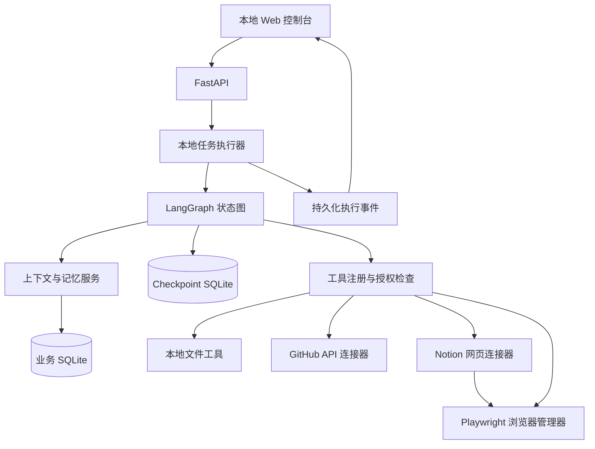

# 个人 Agent 助手 MVP 实现计划

日期：2026-09-10

状态：首版代码已落地并通过主流程最小测试；真实模型和 Notion 账号联调待用户配置。本文保留目标方案，实际实现差异见 README。

项目目录：`E:\bbbooottt`

## 1. 项目定位

构建一个本地运行的个人助手，能够理解自然语言目标，读取本地资料，连接 Web 平台，操作已登录的浏览器，并在不同对话之间使用相关记忆。

这是用于简历展示的个人助手项目，业务用途不限于求职。重点展示三个能力：跨来源理解、统一连接器、可验证的真实操作。参考 AstrBot 的 Provider、工具注册、会话隔离和生命周期设计，独立实现适合本项目的轻量架构。

第一版采用单用户、本机运行、一次执行一个任务的方式。浏览器和后端都运行在用户电脑上，方便登录接管及本地文件访问。“本地运行”不代表模型推理完全离线：使用云模型时，选入上下文的文件片段和网页内容会发送给配置的模型服务。

## 2. 演示闭环与范围

### 2.1 主演示：本地资料 → GitHub → Notion → 本地报告

用户输入：

> 阅读我授权目录里的项目笔记，查询指定 GitHub 仓库的相关 Issue，整理进展，在浏览器里打开 Notion 的项目页面，把摘要追加进去，最后按我的偏好保存本地报告。

执行结果必须包含：读取了哪些文件、引用了哪些 Issue、更新了哪个 Notion 页面、本地报告保存路径。不能只用聊天回复宣称成功。

技术路线：本地文件工具读取笔记；GitHub API 读取 Issue；Playwright 在用户已登录的 Notion 页面完成追加；本地工具写 Markdown 报告。这样主流程确实包含浏览器操作，不会被全部 API 调用替代。

### 2.2 记忆演示

1. 在对话 A 中说：“记住：以后报告用中文 Markdown，默认保存到授权目录的 reports。”
2. 新建对话 B，要求生成报告，系统读取相关长期偏好。
3. 对话 B 不自动加载对话 A 的全部聊天记录。
4. 用户问“上次那份报告在哪”，Agent 调用历史任务搜索，返回已保存的产物记录；存在多个候选时请求澄清。
5. 用户删除该偏好后，新请求不再注入它。

### 2.3 第一版包含

| 能力 | MVP 范围 |
|---|---|
| 本地工具 | 授权目录内列举、文本搜索、读取 TXT/Markdown/文本型 PDF、创建 Markdown 报告 |
| GitHub 连接器 | 查询指定仓库 Issue、读取 Issue 详情，支持用户配置凭证 |
| Notion 网页连接器 | 打开用户指定的已有页面、读取内容、追加段落、回读验证 |
| 通用浏览器基础 | 观察页面、导航、点击、输入、按键、滚动、截图 |
| 理解与执行 | 多轮指代、选择工具、逐步执行、有限重试、取消、结果验证 |
| 登录协同 | 独立持久化 Profile，人工登录/二次验证后恢复 |
| 短期记忆 | 当前对话消息、摘要、当前任务状态和工具结果引用 |
| 长期记忆 | 用户明确要求记住的偏好/事实，查看、修改、删除 |
| 历史检索 | 按关键词、时间、会话搜索已完成任务及报告 |
| 前端 | 对话与任务时间线、连接器设置、记忆管理 |

### 2.4 后续范围

通用桌面应用鼠标键盘操控、任意 Shell 执行、扫描 PDF OCR、多 Agent、定时任务、多用户、移动端、更多平台和向量 RAG 放在后续迭代。本版电脑操作范围是本地文件与浏览器；不宣称能自动完成任意网站任务。

## 3. 技术栈决定

| 组件 | 选择 | 原因 |
|---|---|---|
| Python 环境 | Python 3.12 + uv | 管理依赖和可复现环境 |
| API | FastAPI + Uvicorn | 异步接口、校验、流式事件 |
| 数据契约 | Pydantic v2 | 校验模型输出、工具参数和 API 数据 |
| Agent 编排 | LangGraph | 显式状态、条件路由、checkpoint、interrupt/resume |
| 模型调用 | langchain-openai | 对接支持工具调用的 OpenAI 兼容模型，统一消息结构 |
| HTTP 连接器 | httpx AsyncClient | GitHub API、超时与错误处理 |
| 浏览器 | Playwright Python，headed Chromium | DOM 操作、登录态复用、人工接管 |
| 业务持久化 | SQLite + SQLAlchemy 2 async + aiosqlite + Alembic | 本地低成本启动，明确表结构和迁移 |
| 图状态持久化 | langgraph-checkpoint-sqlite | 保存图执行状态，使用独立 checkpoint 数据库 |
| 文档解析 | pypdf + Python 标准库 | 支持文本型 PDF 和普通文本 |
| 前端 | React + TypeScript + Vite | 展示对话、工具执行和接管状态 |
| 实时进度 | SSE + REST | 服务端单向推送；创建、继续、取消走 REST |
| 凭证 | 系统 keyring；开发环境使用本地环境变量 | 数据库只保存凭证引用 |
| 验证 | pytest、pytest-asyncio、httpx、Playwright、Ruff | 覆盖流程、接口与浏览器行为 |

版本在实施时确认兼容关系并锁定。OpenAI 兼容不代表所有模型都支持同样的工具调用、流式输出或图像输入，第一版先验证一个主模型。

不再同时自研第二套 Agent 主循环；LangGraph 负责编排，自己的代码负责工具、连接器、权限、验证和记忆。SSE 替代前面讨论的 WebSocket，用于减少第一版双向协议的复杂度。

## 4. 系统结构



本地任务执行器使用受 FastAPI lifespan 管理的任务队列和后台协程；任务创建时先落库再排队。进程内队列只是调度设施，数据库和 checkpoint 才是恢复依据。初期一个 Uvicorn worker、一个执行槽，避免共享浏览器同时被多个任务控制。

## 5. Agent 执行流程

```text
载入会话、任务和相关记忆
  → 理解目标，生成简短可更新的计划
  → 选择下一工具及结构化参数
  → 校验参数、权限和当前授权
  → 如需用户输入/接管，保存状态并暂停
  → 执行工具
  → 独立验证结果并保存证据
  → 更新计划，继续或结束
```

状态：`PENDING → RUNNING → WAITING_USER / SUCCEEDED / FAILED / CANCELLED`。

- 等待原因单独记录：`login`、`verification`、`approval`、`clarification`、`recovery_check`。
- `WAITING_USER` 通过 LangGraph interrupt 持久化，恢复接口通过同一图 thread 执行 resume。
- MVP 为每个 task 使用独立 graph thread；conversation 的连续上下文由上下文服务装配。
- 默认最多 20 次工具动作、单个可重试读操作最多重试 2 次，模型/网络调用配置超时。限制可配置，并在 UI 显示停止原因。
- UI 展示计划、动作、观察摘要和证据，不存储或展示模型私有思维链。
- 超时不等于写入失败：写操作出现不确定结果时先回读核对，不能直接重复提交。

### 恢复边界

Checkpoint 保存的是可序列化状态，不保存活的 Playwright Page、数据库连接或完整进程。后端重启后重新打开独立 Profile 和目标 URL，再验证真实状态。

LangGraph 恢复可能重新执行节点内代码。因此：

1. 接管/审批节点与产生副作用的工具节点分离。
2. 工具调用保存稳定的 operation_id、开始状态、结果和外部对象/产物标识。
3. 已完成且已验证的写操作复用结果；未确定完成的写操作进入核对流程。
4. Notion 追加使用操作标记或可核对的内容指纹，恢复时先检查是否已经存在。
5. 取消会停止后续动作，但不保证撤销已经完成的外部写入；结果列表保留已完成部分。

## 6. 工具和连接器契约

连接器描述平台、认证方式、状态与能力集合；每项能力注册为工具。Agent 调用业务能力，连接器内部负责 API 或网页实现。

工具定义至少包含：`name`、`description`、Pydantic 参数模型、读写属性、目标范围、超时和执行函数。工具结果包含：`status`、`data`、`error_code`、`retryable`、`evidence_refs`、`operation_id`。

建议结果状态：`ok`、`error`、`needs_user`、`uncertain`，以区分执行错误、需要接管和写入结果不确定。

最小工具集合：

| 分类 | 工具 |
|---|---|
| 本地 | `local.list_files`、`local.search_text`、`local.read_document`、`local.write_report` |
| GitHub | `github.search_issues`、`github.get_issue` |
| Notion | `notion.read_page`、`notion.append_summary` |
| 浏览器 | `browser.observe`、`browser.navigate`、`browser.click`、`browser.fill`、`browser.press`、`browser.scroll` |
| 记忆 | `memory.search`、`memory.save`、`memory.update`、`memory.delete` |
| 历史 | `history.search_tasks`、`history.get_task` |

写报告由后端决定授权根目录，模型只提供相对路径与内容。Notion 连接器首先验证指定页面是否可编辑；第一版不自动搜索所有工作区或修改数据库 schema。

## 7. 浏览器控制原理与实现

### 观察 → 行动 → 验证

1. Playwright 启动专用 Profile 的可见浏览器，不使用用户日常 Chrome 默认 Profile。
2. Observer 获取 URL、页面标题、主要文本、可交互元素的 role/name，以及必要截图。
3. 每次观察生成有版本号的元素引用。模型选择当前观察中的元素，而不是凭空编写 CSS selector。
4. Executor 将动作映射到 Playwright locator，利用自动等待、可见性与可点击性检查执行。
5. 页面跳转或重绘后重新观察；过期引用作废。
6. Validator 回读新增文本、对象链接或状态，生成成功证据。

优先 DOM 和语义定位；截图用于辅助理解与用户检查。坐标点击只在已观察到的页面范围内作为后续增强，不承诺首版支持复杂画布应用。

### 登录与用户接管

用户首次在专用浏览器登录 Notion。Cookie 和其他浏览器状态留在本地 Profile；Profile 不入 Git，不暴露给模型。持久化会话仍可能过期，不能保证所有网站始终允许自动化。

检测到登录页、验证页面或无法确定的访问阻断时，Agent 暂停并展示原因。用户在本机浏览器处理后点击继续，系统重新观察页面确认可访问再执行。检测可能存在误判，UI 同时提供手动接管按钮。

MVP 的验证码流程采用人工处理；不以自动破解验证码作为验收目标。

## 8. 短期记忆、长期记忆与跨对话数据

模型不会自动拥有所有历史记录。后端根据身份、会话和任务组装每次调用的上下文。

### 短期记忆

保存当前 conversation 的消息、较早消息的摘要、当前 task 的计划与已验证结果。每次只注入在 token 预算内的最近消息、摘要和相关工具结果。

大文件、整页 DOM 和截图作为 artifact 保存，通过引用获取需要的片段，避免所有工具结果不断占满上下文。压缩历史时保留完整的工具调用与结果配对。

### 长期记忆

第一版只把用户明确要求长期保存的信息写入 memories，例如语言、报告格式和常用项目。记录 `key`、`value`、作用域、来源消息、更新时间和有效状态。

- 稳定偏好使用结构化 key-value 存储，先按当前项目和用户精确匹配。
- 新偏好更新同一作用域的旧值，保留必要变更记录；避免同时注入互相矛盾的偏好。
- 用户可以查看、修改、删除记忆；删除后不再检索或注入。
- 记忆不构成权限授权。记住一个目录不代表自动获得访问权限。
- 密码、Token、Cookie 不进入长期记忆或模型上下文。

### 跨对话历史

`user_id` 表示数据归属，`conversation_id` 隔离聊天，`task_id` 标识可恢复任务；可选的 `project_key` 隔离项目偏好。

普通新对话只注入相关长期记忆。用户提到过去的任务时，再调用历史搜索并读取选中的历史摘要与产物。不能把所有会话自动混合；“刚才那个”有歧义时明确询问。

MVP 单用户身份由后端固定生成，仍在所有查询里做归属校验；客户端不能靠传一个任意 user_id 读取数据。

### RAG 的迭代位置

RAG 是“检索资料再交给模型生成”的流程，向量检索只是其中一种检索方式，不是 RAG 的替代品。

MVP 使用结构化偏好查询、关键词历史检索、文件按需读取。下一版根据真实问题集加入分块、Embedding、向量召回和来源引用；数据规模需要时再迁移 PostgreSQL + pgvector，并评估是否加入关键词混合检索。当前状态、精确偏好和授权数据仍由业务数据库管理。

## 9. 最小持久化模型

| 表 | 关键字段 | 职责 |
|---|---|---|
| conversations | id, user_id, title, summary, project_key, timestamps | 会话与压缩摘要 |
| messages | id, conversation_id, role, content, tool_call_id, created_at | 对话历史 |
| tasks | id, user_id, conversation_id, goal, status, waiting_reason, graph_thread_id, timestamps | 任务生命周期 |
| tool_calls | id, task_id, operation_id, tool_name, args, status, result_ref, error, timestamps | 操作记录与重复执行核对 |
| task_events | id, task_id, event_type, payload, created_at | SSE 事件回放 |
| memories | id, user_id, project_key, key, value, source_message_id, active, timestamps | 长期偏好和事实 |
| connector_accounts | id, user_id, connector_type, credential_ref, status, config | 平台配置，排除明文凭证 |
| artifacts | id, task_id, kind, path_or_url, checksum, metadata | 报告、观察截图和证据 |

图执行的 plan、游标和节点状态由 checkpoint 负责；业务 tasks 保存 UI 状态投影。统一通过状态更新服务同步事件与任务状态，启动时根据 checkpoint 对未结束任务进行核对，避免两套可独立修改的执行计划。

工具参数和事件写日志前清理凭证及敏感字段；限制工具输出大小。

## 10. API 与前端

| 接口 | 功能 |
|---|---|
| `POST /api/conversations` | 新建对话 |
| `GET /api/conversations/{id}/messages` | 获取当前对话消息 |
| `POST /api/conversations/{id}/messages` | 保存用户输入并创建任务，返回 task_id |
| `GET /api/tasks/{id}` | 获取任务及已完成操作 |
| `GET /api/tasks/{id}/events` | SSE 推送，支持按事件 ID 补读 |
| `POST /api/tasks/{id}/resume` | 提交回答/审批或通知接管完成 |
| `POST /api/tasks/{id}/cancel` | 取消后续执行 |
| `GET /api/connectors` | 查看平台配置状态 |
| `PUT /api/connectors/{name}` | 配置指定仓库、页面及凭证引用 |
| `POST /api/browser/session` | 打开专用浏览器以便登录 |
| `GET/POST /api/memories` | 查看、新增记忆 |
| `PATCH/DELETE /api/memories/{id}` | 修改、删除记忆 |

事件包括 `task_started`、`plan_updated`、`tool_started`、`tool_finished`、`waiting_user`、`artifact_created`、`task_completed`、`task_failed`、`task_cancelled`。模型文本 token 可以即时推送，稳定的任务状态和工具结果需要持久化。

前端采用一个主工作台：左侧会话列表、中间聊天、右侧任务时间线和产物。设置页提供连接器、授权目录、模型配置与记忆管理。登录接管使用本机浏览器窗口，无需第一版搭建远程桌面视频流。

## 11. 本地访问与授权边界

- 后端默认绑定 loopback，检查来源并使用本地会话凭证；有写操作的接口不能允许任意网页跨域调用。
- 本地文件工具解析真实路径，校验其仍位于授权目录内，包括 `..`、符号链接和 Windows junction 场景。
- 默认创建新报告；覆盖已有文件必须有相应任务授权。第一版不提供通用删除和任意 Shell 工具。
- 已有明确授权可覆盖一次任务内同类操作，不逐次重复询问。目标或动作超出授权时才补充确认。
- 文档和网页内容视为任务数据，不能通过其中的文字更改工具权限或指示 Agent 外传文件。
- 导航、文件上传和跨平台内容写入检查目的地与任务目标；凭证不交给模型。
- 对外写入记录具体目的地、内容和证据，失败时保留已完成结果。

## 12. 开发顺序

以下按依赖顺序推进，每步通过验收后再进入下一步；不以日期代替完成标准。

- [ ] **1. 建立工程骨架。** 创建后端/前端、uv 锁文件、配置模板和本地启动说明；FastAPI 健康接口可访问，React 可连接后端。
- [ ] **2. 实现会话和任务持久化。** 建表、迁移、消息提交、任务查询和 SSE；刷新页面能够回放任务事件。
- [ ] **3. 接通 LangGraph 与主模型。** 使用一个无副作用测试工具完成模型选工具、执行、回传和总结；接入 SQLite checkpointer、超时及最大动作数。
- [ ] **4. 实现本地工具。** 完成授权目录检查、TXT/Markdown/PDF 读取、关键词搜索和报告生成；实际读写产物可核对。
- [ ] **5. 实现长短期记忆。** 完成当前会话上下文、明确偏好写入/编辑/删除及历史任务搜索；通过跨对话隔离演示。
- [ ] **6. 接入 GitHub API。** 实现 Issue 检索和详情、凭证状态、分页上限及限流处理；返回可追溯来源链接。
- [ ] **7. 接入浏览器与 Notion。** 实现专用 Profile、观察动作循环、Notion 页面读取/追加和回读；用测试页面验证登录接管后，再在真实 Notion 页面验收。
- [ ] **8. 完成暂停、恢复与取消。** 分离 interrupt 和副作用节点，补充 operation_id、重启核对及不确定写入处理；验证恢复不重复追加。
- [ ] **9. 完成工作台。** 显示会话、工具时间线、接管原因、继续/取消按钮、记忆设置和报告链接；在本机完成整个主演示。
- [ ] **10. 完成回归与展示材料。** 建立固定任务集、运行关键测试、记录实测数据，编写架构说明并录制演示。

## 13. 验收与测试

| 场景 | 通过条件 |
|---|---|
| 本地理解 | 正确读取指定资料，摘要中能定位对应文件；不读取未授权目录 |
| 跨平台闭环 | GitHub 结果含来源；Notion 确认追加；Markdown 文件存在且内容一致 |
| 真实浏览器能力 | 主演示有实际 DOM 观察、输入和回读过程，日志有证据 |
| 多轮理解 | “只整理今天的”“保存到刚才的目录”等修改作用于当前任务或明确目标 |
| 新对话记忆 | 新对话使用有效长期偏好，不自动泄漏其他对话原文 |
| 记忆变更 | 更新后只使用新值；删除后不再召回；记忆不扩大目录权限 |
| 用户接管 | 检测阻断后进入 WAITING_USER，继续后重新验证页面 |
| 服务重启 | 等待期间重启后仍可恢复；正在执行的未知写入先核对 |
| 重复提交 | 相同 operation_id 不导致重复 Notion 段落或重复本地报告 |
| 局部失败 | Notion 失败时准确报告失败及已完成的 GitHub/本地结果 |
| 取消任务 | 取消后不启动新工具；已经完成的操作仍展示 |
| 前端断线 | 重新连接 SSE 后补读稳定事件，不重复渲染同一事件 |

测试分三层：

1. 单元测试：路径边界、记忆作用域与冲突、参数校验、重试分类。
2. 集成测试：使用假的模型和连接器测试图路由、interrupt/resume、重复恢复、SSE 回放。
3. 端到端测试：自建固定网页验证浏览器操作和接管状态，真实 GitHub/Notion 做有授权的人工冒烟验收。不能仅凭固定网页通过就宣称所有第三方站点可用。

以约 10 个固定任务构建第一版评估集，记录完成率、错误归因、工具调用次数、耗时、Token、接管次数和重复写入次数。指标先实测再用于简历，不预填性能提升或成功率。

## 14. 推荐目录与运行方式

```text
E:\bbbooottt\
├── MVP_PLAN.md
├── backend/
│   ├── pyproject.toml
│   ├── uv.lock
│   ├── app/
│   │   ├── main.py
│   │   ├── api/
│   │   ├── agent/          # Graph、状态、上下文组装
│   │   ├── tools/          # 注册表、本地能力、结果模型
│   │   ├── connectors/     # GitHub、Notion 网页能力
│   │   ├── browser/        # Profile、观察、动作、验证
│   │   ├── memory/         # 偏好、摘要、历史检索
│   │   ├── tasks/          # 调度、恢复、事件、取消
│   │   ├── storage/        # ORM、仓库、迁移
│   │   └── security/       # 路径、授权、凭证引用
│   └── tests/
├── frontend/
├── docs/
│   └── demo-cases.md
└── data/                   # 运行时数据，整体不入 Git
    ├── app.sqlite
    ├── checkpoints.sqlite
    ├── browser_profiles/
    ├── workspace/
    └── artifacts/
```

MVP 在 Windows 本机运行 FastAPI 与 headed Chromium，前端开发时用 Vite，发布演示时可构建静态文件由后端提供。初期不把可见浏览器装进 Docker；后续如果云部署，再拆本地执行服务和远程控制面。

## 15. 参考与取舍依据

以下资料来自前序对话已完成的搜索，仅用于设计参考，未在本次写文档时重新核验版本。

- [LangGraph Overview](https://docs.langchain.com/oss/python/langgraph/overview)：参考持久化、流式与人工介入能力；本项目显式设计任务和副作用边界。
- [Playwright Authentication](https://playwright.dev/python/docs/auth)：参考认证状态复用；本项目使用专用浏览器 Profile。
- [Playwright BrowserType](https://playwright.dev/python/docs/api/class-browsertype)：参考 launch_persistent_context；实施时核对浏览器版本及参数。
- [browser-use](https://github.com/browser-use/browser-use)：参考网页观察和 Agent 操作思路；MVP 先实现窄范围 Playwright 执行层，不引入第二套主编排器。
- 本地 `E:\AstrBot-master`：参考 Provider、Star 工具注册、事件上下文、任务生命周期和工具循环。源码细节以实际实现为准，前期概览不视为完整审计。

第一版的完成标志是：一个任务真实地贯通本地资料、GitHub 和已登录 Notion 浏览器操作；可以使用跨对话偏好，在接管后恢复，并给出能够核验的网页与文件结果。

## 16. 本次实施记录（2026-09-10）

按用户要求分步骤实施，每一步仅做主流程所需的最小测试。

| 步骤 | 已完成实现 | 最小测试结果 |
|---|---|---|
| 1 基础服务 | FastAPI、Alembic、会话/任务/事件、记忆 CRUD | 重启后会话和记忆仍存在，通过 |
| 2 本地工具与记忆 | 文档读取、搜索、Markdown 报告、长期偏好与历史工具 | 读笔记、写报告、重复调用与记忆读取，通过 |
| 3 Agent 编排 | LangGraph 工具循环、SQLite checkpoint、用户中断、取消 | 暂停后关闭执行器，重启并确认继续，通过 |
| 4 平台连接器 | GitHub Issue API、Playwright、Notion 页面适配 | Mock GitHub 读取和浏览器测试页追加/刷新回读，通过 |
| 5 工作台 | React 会话、任务时间线、设置、记忆管理 | 页面导航、任务建议、四种屏宽及无 JS 运行错误，通过 |
| 6 整体闭环 | API → Agent → 文件工具 → 产物 → SSE | 脚本化模型驱动的本地报告工作流，通过 |

启动说明：`README.md`；启动脚本：`scripts/start.ps1`。

尚未完成的验收：真实模型选择与工具调用质量、用户 GitHub 凭证、真实 Notion 登录及完整跨平台演示、固定任务集的实测指标。不把浏览器测试页通过等同于真实 Notion 验收。原开发清单的复合验收仍按以上条件判断。

为控制第一版范围，采用单文件业务模块、设置文件而非 connector_accounts 表、最近消息与最近任务摘要、最近 12 条长期偏好注入。项目作用域记忆、向量 RAG、完整历史压缩和通用桌面操控留待后续。
